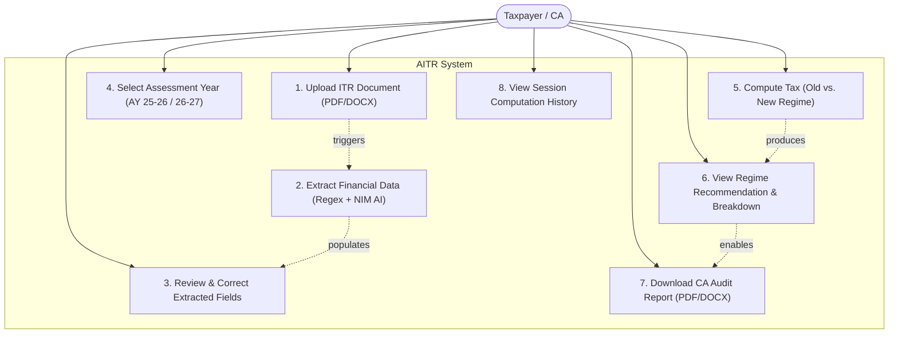
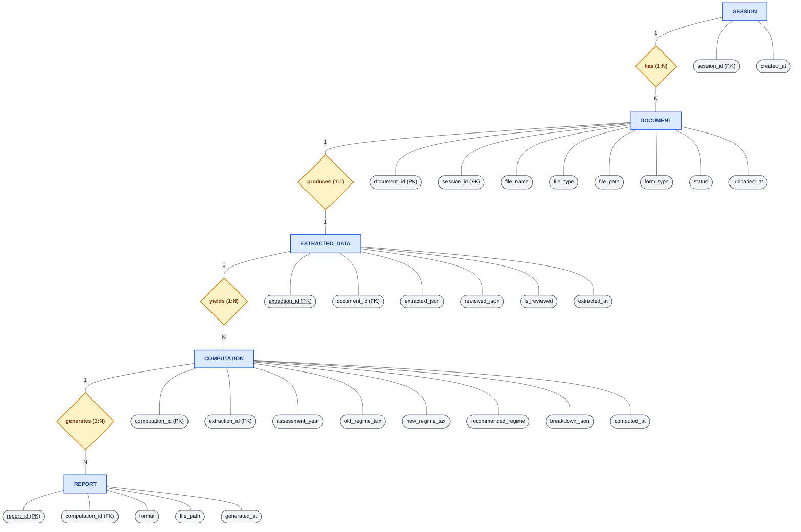
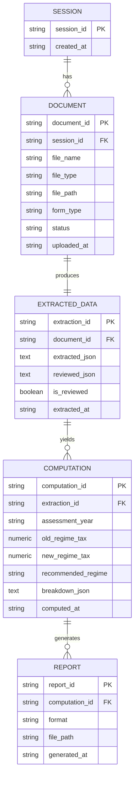
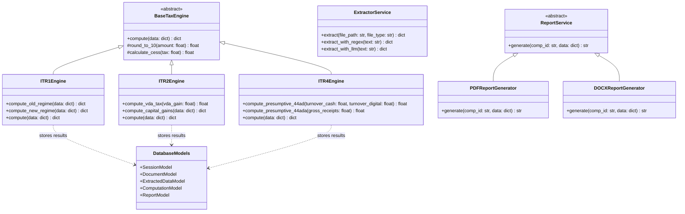
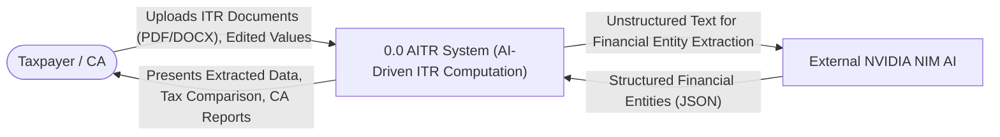
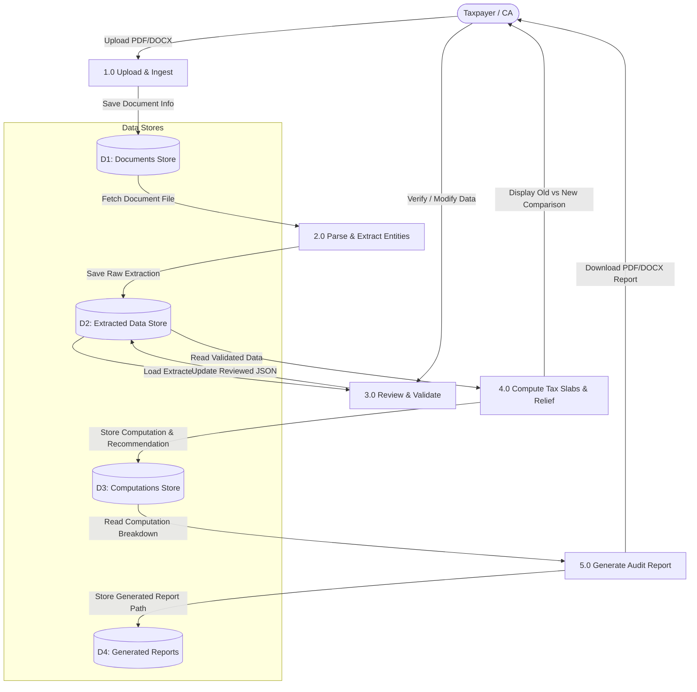

# Software Requirements Specification (SRS)
## AI-Driven Income Tax Return (ITR) Computation System (AITR)

**Academic Project Context:**  
*Department of Computer Science, Aligarh Muslim University (AMU)*  
*MCA Mini Project | Academic Session 2026–27*  
*Author:* Tabish Hasan (Enrolment / Roll No: 25CAMSA156)

---

## 1. Introduction

### 1.1 Purpose
The purpose of this Software Requirements Specification (SRS) is to provide a complete, formal, and unambiguous specification of the requirements for the **AI-Driven Income Tax Return (ITR) Computation System (AITR)**. This document outlines the functional features, architectural specifications, deterministic tax computation models across Indian Assessment Years (AY 2025-26 & AY 2026-27), database designs, external interfaces, and UML/Data Flow models conforming to IEEE 830 standards.

### 1.2 Scope of the System
AITR is a full-stack, enterprise-grade automated financial platform tailored for Indian taxpayers and Chartered Accountants (CAs). The platform automates:
1. **Document Ingestion:** Secure uploading of raw ITR acknowledgement PDFs and Word (DOCX) financial filings.
2. **Hybrid Extraction Engine:** Multi-layer text parsing utilizing high-precision regex along with NVIDIA NIM LLM reasoning to extract financial heads, Chapter VI-A deductions, VDA (Virtual Digital Assets / crypto) gains, and TDS amounts.
3. **Deterministic Multi-Regime Tax Computation:** Strict execution of the Indian Income Tax Act, 1961 (covering ITR-1 Sahaj, ITR-2 Capital Gains/VDA, and ITR-4 Sugam presumptive business taxation under Sections 44AD/ADA/AE) with dual-regime comparison (Old vs. New Tax Regime).
4. **Automated CA-Standard Audit Reporting:** Immediate generation of downloadable, print-ready reports in both PDF and Word DOCX formats with full tax slab breakdowns.
5. **Interactive Real-time Visual Frontend:** React 18, Tailwind CSS, and a Three.js WebGL GridScan shader background displaying processing status.

### 1.3 Definitions, Acronyms, and Abbreviations
- **ITR:** Income Tax Return
- **AY:** Assessment Year (e.g., AY 2025-26, AY 2026-27)
- **FY:** Financial Year (Previous Year)
- **PAN:** Permanent Account Number (10-character alphanumeric Indian tax identifier)
- **VDA:** Virtual Digital Assets (Cryptocurrency, NFTs) governed under Section 115BBH
- **TDS:** Tax Deducted at Source
- **Rebate u/s 87A:** Income tax relief for eligible resident individuals
- **NIM:** NVIDIA Inference Microservice (LLM service)
- **ORM:** Object-Relational Mapping (SQLAlchemy)
- **WAL:** Write-Ahead Logging (SQLite concurrency mode)

### 1.4 References
- Indian Income Tax Act, 1961 and Annual Finance Acts (Finance Act 2023, 2024, 2025).
- Central Board of Direct Taxes (CBDT) e-Filing Rules and Utility Specifications.
- IEEE Std 830-1998: IEEE Recommended Practice for Software Requirements Specifications.

---

## 2. Overall Description

### 2.1 Product Perspective
AITR functions as a decoupled client-server architecture. The frontend is a single-page application (SPA) built using React and Vite, interacting via asynchronous RESTful APIs (`/api/*`) with a high-performance Python FastAPI service. The backend coordinates document parsing, an extraction engine, a deterministic calculation engine, an SQLite persistent database, and document generation modules.

```
+-------------------------------------------------------------------------+
|                         React Frontend (SPA)                            |
|     [GridScan WebGL] <---> [Upload] <---> [Review] <---> [Results]      |
+------------------------------------+------------------------------------+
                                     | HTTP REST (JSON / Multipart)
+------------------------------------v------------------------------------+
|                         FastAPI Backend                                 |
|  +----------------+  +-----------------+  +--------------------------+  |
|  | Document Parser|  | Hybrid Extractor|  | Deterministic Tax Engine |  |
|  | (pdfplumber /  |  | (Regex Rules +  |  | (ITR-1, ITR-2, ITR-4     |  |
|  |  python-docx)  |  |  NVIDIA NIM LLM)|  |  Old vs. New Slabs)      |  |
|  +----------------+  +-----------------+  +--------------------------+  |
|                                    |                                    |
|          +-------------------------+--------------------------+         |
|          |                                                    |         |
|  +-------v--------------+                          +----------v------+  |
|  | SQLite DB (SQLAlchemy|                          | Report Generator|  |
|  | Session/Doc/Extract/ |                          | (ReportLab PDF/ |  |
|  | Computation/Report)  |                          |  python-docx)   |  |
|  +----------------------+                          +-----------------+  |
+-------------------------------------------------------------------------+
```

### 2.2 User Characteristics
- **Individual Taxpayers:** Require an intuitive UI, fast document upload, automated parsing, transparent comparison of Old vs. New regime taxes, and advice on which regime yields lower tax liability.
- **Tax Practitioners & Chartered Accountants:** Require accurate calculations under Sections 115BAC, 115BBH, 87A, 44AD/ADA, precision rounding to nearest rupee, and exportable CA-format computation notes.

### 2.3 Operating Environment
- **Server:** Python 3.10+ on Windows/Linux; FastAPI, Uvicorn, SQLite3 with WAL enabled.
- **Client:** Modern Web Browsers supporting WebGL 2.0 and ECMAScript 2020+ (Chrome, Firefox, Safari, Edge).
- **External Dependencies:** NVIDIA NIM OpenAI-compatible API for LLM inference (via `api.integrate.nvidia.com`).

---

## 3. System Features & Functional Requirements

### 3.1 Module 1: Document Upload & Session Management
- **FR-1.1:** System shall assign or retrieve an isolated `session_id` stored within the client's local storage.
- **FR-1.2:** System shall support uploading PDF and DOCX files up to 25MB.
- **FR-1.3:** System shall sanitize file names, store them securely in the `uploads/` directory, and record initial state as `UPLOADED`.

### 3.2 Module 2: Document Parsing & Information Extraction
- **FR-2.1:** Extraction pipeline shall detect form types (`ITR-1`, `ITR-2`, `ITR-4`) from header keywords and filing acknowledgements.
- **FR-2.2:** System shall parse textual structures using `pdfplumber` and `python-docx`.
- **FR-2.3:** Deterministic regular expressions shall capture PAN (`[A-Z]{5}[0-9]{4}[A-Z]`), Aadhaar, Assessment Year, Filing Date, and financial heads.
- **FR-2.4:** Unstructured documents shall be processed by NVIDIA NIM LLM with JSON Schema output validation.
- **FR-2.5:** System shall extract VDA (Cryptocurrency) gains under Section 115BBH and Presumptive Gross Turnover under Section 44AD/44ADA.

### 3.3 Module 3: Interactive Data Review & Validation
- **FR-3.1:** System shall display extracted fields on the interactive Review page.
- **FR-3.2:** System shall permit manual override and correction of any field by the user prior to tax computation.
- **FR-3.3:** Form inputs must remain legible with high-contrast text and responsive layout.

### 3.4 Module 4: Deterministic Tax Computation Engine
- **FR-4.1 (Assessment Years):** Engine shall calculate taxes dynamically for both **AY 2025-26** and **AY 2026-27**.
- **FR-4.2 (Old Regime):**
  - Standard Deduction: ₹50,000.
  - Slabs: 0–2.5L (0%), 2.5L–5L (5%), 5L–10L (20%), >10L (30%).
  - Chapter VI-A Deductions: 80C (up to 1.5L), 80D, 80TTA (up to 10K).
  - Section 87A rebate: Up to ₹12,500 for total taxable income up to ₹5,00,000.
- **FR-4.3 (New Regime u/s 115BAC):**
  - Standard Deduction: ₹75,000 (effective AY 2025-26 onwards).
  - Slabs (AY 2025-26 / 2026-27): 0–3L (0%), 3L–7L (5%), 7L–10L (10%), 10L–12L (15%), 12L–15L (20%), >15L (30%).
  - Section 87A rebate: Full tax rebate if total income does not exceed ₹7,00,000 (max relief ₹25,000).
- **FR-4.4 (Special Rates - ITR-2):**
  - Section 115BBH: VDA gains taxed flat at 30% + 4% Health & Education Cess. No deductions allowed.
  - Section 111A (STCG): Taxed at 15% / 20%. Section 112 (LTCG): Taxed at 10% / 12.5%.
- **FR-4.5 (Presumptive - ITR-4):**
  - 44AD: Minimum 6% (digital) / 8% (cash) deemed profit.
  - 44ADA: Minimum 50% deemed profit on professional gross receipts.
- **FR-4.6 (Final Tax & Cess):**
  - Health & Education Cess applied flat at 4% on (Base Tax + Special Tax - Rebate 87A).
  - Final total tax and refund rounded to the **nearest rupee**. Taxable total income rounded to the **nearest ₹10** (Sec 288A).

### 3.5 Module 5: Audit Report Generation
- **FR-5.1:** Generate PDF report using `ReportLab` matching official CA audit note standards.
- **FR-5.2:** Generate DOCX report using `python-docx` containing itemized tabular computations.
- **FR-5.3:** Reports must state recommended regime, net tax payable or refundable, and timestamp.

---

## 4. Non-Functional Requirements

- **NFR-1 (Performance & Latency):** Local regex extraction and deterministic tax computation shall complete within 200ms. PDF and DOCX report generation shall complete within 1.5 seconds.
- **NFR-2 (Accuracy & Determinism):** Tax engines shall produce mathematically accurate results identical to CBDT's e-filing portal calculation rules.
- **NFR-3 (Data Privacy & Isolation):** All files uploaded and computed are segregated by session UUIDs. No permanent unencrypted storage of user PAN or personal identity data is exposed publicly.
- **NFR-4 (Extensibility):** Tax slabs and rules are isolated in `config.py` and modular tax engine classes to accommodate future budget revisions without altering business logic.

---

## 5. System Modeling & Diagrams

### 5.1 Use Case Diagram



---

### 5.2 Entity-Relationship (ER) Diagram

#### 5.2.1 Classical / Chen's ER Notation (Rectangles, Diamonds, Ovals)
In standard database modeling (Chen's notation required in academic curricula like AMU MCA):
* **Rectangles `[...]`** represent **Entities** (strong/weak tables).
* **Diamonds `{...}`** represent **Relationships** with cardinality ratios (1:N, 1:1).
* **Ovals `(...)`** represent **Attributes** (with Key attributes underlined / denoted with `PK` or `*`).



#### 5.2.2 Relational Physical Schema (Crow's Foot Notation)
Complementing the classical conceptual ER diagram, the physical schema below provides exact SQLite column types and constraints:



---

### 5.3 Class Diagram
Structure of the backend application architecture showing relationships between controllers, models, and calculation engines.



---

### 5.4 Sequence Diagram: End-to-End Execution Flow

```mermaid
sequenceDiagram
    autonumber
    actor User as Taxpayer / CA
    participant UI as React Frontend
    participant API as FastAPI Router
    participant DB as SQLite Database
    participant Ext as Extractor Service
    participant Eng as Tax Computation Engine
    participant Rep as Report Generator

    User->>UI: 1. Selects & uploads ITR file (PDF/DOCX)
    UI->>API: POST /api/upload (file, session_id)
    API->>DB: Save DocumentModel (status: UPLOADED)
    API-->>UI: Return document_id
    
    UI->>API: POST /api/extract/{document_id}
    API->>Ext: Parse file & extract fields (Regex + LLM)
    Ext-->>API: Extracted structured JSON
    API->>DB: Save ExtractedDataModel
    API-->>UI: Return extraction_id & extracted fields
    
    User->>UI: 2. Reviews/edits values & selects AY
    UI->>API: PUT /api/review/{extraction_id} (reviewed_json)
    API->>DB: Update reviewed_json (is_reviewed = true)
    
    User->>UI: 3. Clicks "Calculate Tax"
    UI->>API: POST /api/compute/{extraction_id}
    API->>Eng: Invoke TaxEngine (AY, Form, Reviewed Data)
    Eng->>Eng: Compute Old Regime vs New Regime (Slabs, 87A, VDA, Cess)
    Eng-->>API: Breakdown, Old Tax, New Tax, Recommendation
    API->>DB: Save ComputationModel
    API-->>UI: Return computation results
    
    User->>UI: 4. Clicks "Download PDF / DOCX Report"
    UI->>API: POST /api/reports/generate/{comp_id}/{format}
    API->>Rep: Generate CA-format Report
    Rep-->>API: File generated
    API->>DB: Save ReportModel
    API-->>UI: Return download_url
    UI->>User: Deliver audit computation report
```



---

### 5.5 Data Flow Diagram (DFD)

#### Level 0 DFD (Context Diagram)



#### Level 1 DFD (Subsystem Decomposition)



---

## 6. Verification & Mathematical Formulation

### 6.1 Tax Rounding Standards
Under Section 288A of the Indian Income Tax Act, 1961:
$$\text{Taxable Total Income} = 10 \times \operatorname{round}\left(\frac{\text{Computed Income}}{10}\right)$$
Under Section 288B and e-filing calculation rules:
$$\text{Total Tax Payable / Refundable} = \operatorname{round}(\text{Net Tax Liability})$$

### 6.2 Health & Education Cess
$$\text{Cess} = 0.04 \times \max(0, \, \text{Base Tax} + \text{Special Rate Tax} - \text{Rebate 87A})$$

### 6.3 Regime Recommendation Rule
$$\text{Recommended Regime} = \begin{cases} 
\text{"NEW"}, & \text{if } \text{Tax}_{\text{New}} < \text{Tax}_{\text{Old}} \\
\text{"OLD"}, & \text{if } \text{Tax}_{\text{Old}} < \text{Tax}_{\text{New}} \\
\text{"EQUAL"}, & \text{if } \text{Tax}_{\text{New}} = \text{Tax}_{\text{Old}}
\end{cases}$$

---

*End of Software Requirements Specification (SRS) for AITR System.*
